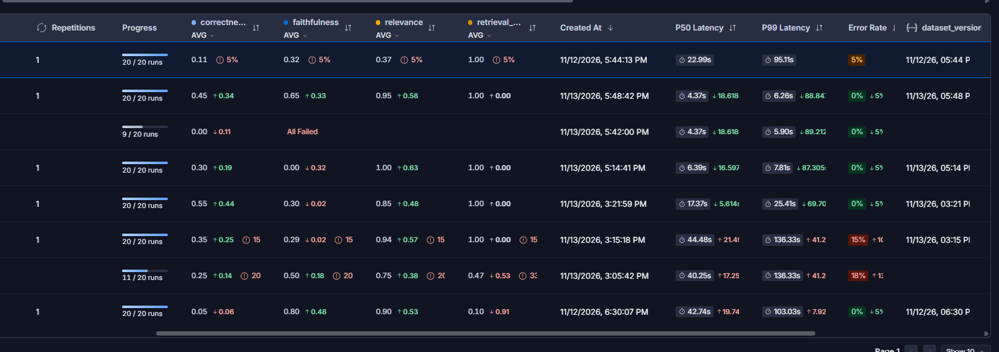

# SentinelRag — AI Security RAG with Hybrid Retrieval & Observability

A production-style **Retrieval-Augmented Generation (RAG)** system for querying trusted AI security, red-teaming, and AI governance documentation.

SentinelRag combines **dense vector retrieval, BM25 lexical retrieval, and Reciprocal Rank Fusion (RRF)** to improve context retrieval before passing the selected documents to an LLM for grounded response generation.

The system uses **FastAPI** for the API layer, **Redis Queue (RQ)** for asynchronous processing, **Qdrant Cloud** for vector search, and **LangSmith** for tracing, evaluation, and observability.


> ### Engineering Highlights
> * Implemented **hybrid retrieval** combining dense vector search (Qdrant Cloud) and BM25 lexical retrieval.
> * Implemented **Reciprocal Rank Fusion (RRF)** to merge independent retrieval rankings.
> * Added **document deduplication** and **Cohere rerank-5-fast** reranking via OpenRouter to improve context quality.
> * Built an **asynchronous RAG execution pipeline** using FastAPI, Redis, and RQ workers.
> * Integrated **LangSmith tracing and LLM-as-a-Judge evaluation** using OpenRouter (`gpt-6-luna`) across correctness, relevance, retrieval relevance, and groundedness.
> * Generation model: **OpenRouter Claude 3.5 Haiku** (`anthropic/claude-3-5-haiku-20241022`) with retry + exponential jitter.
> * Benchmarked at **4.37s P50 and 6.26s P99 latency** (Run 8), down from 22.99s avg / 95.11s P99 baseline.


---

## Architecture

```text
                         ┌──────────────────┐
                         │    User Query    │
                         └────────┬─────────┘
                                  │
                                  ▼
                         ┌──────────────────┐
                         │     FastAPI      │
                         │     REST API     │
                         └────────┬─────────┘
                                  │
                                  ▼
                         ┌──────────────────┐
                         │   Redis Queue    │
                         │       (RQ)       │
                         └────────┬─────────┘
                                  │
                                  ▼
                         ┌──────────────────┐
                         │    RQ Worker     │
                         └────────┬─────────┘
                                  │
                    ┌─────────────┴─────────────┐
                    │                           │
                    ▼                           ▼
            ┌───────────────┐           ┌───────────────┐
            │    Dense      │           │     BM25      │
            │   Retrieval   │           │    Retrieval  │
            │ Qdrant Cloud  │           │    Lexical    │
            └───────┬───────┘           └───────┬───────┘
                    │                           │
                    └─────────────┬─────────────┘
                                  │
                                  ▼
                         ┌──────────────────┐
                         │   RRF Reranking  │
                         │ Reciprocal Rank  │
                         │      Fusion      │
                         └────────┬─────────┘
                                  │
                                  ▼
                         ┌──────────────────┐
                         │ Retrieved Context│
                         └────────┬─────────┘
                                  │
                                  ▼
                         ┌──────────────────┐
                         │       LLM        │
                         └────────┬─────────┘
                                  │
                                  ▼
                         ┌──────────────────┐
                         │ Grounded Answer  │
                         │ + Page Citations │
                         └──────────────────┘
```

---

# Key Features

* **Hybrid RAG architecture**
* Dense semantic retrieval with **Qdrant Cloud**
* Lexical retrieval using **BM25**
* **Reciprocal Rank Fusion (RRF)** for combining retrieval rankings
* Multi-document AI security knowledge base
* PDF ingestion and chunking pipeline
* Embedding-based document indexing
* Grounded responses with source/page citations
* Asynchronous processing using **Redis Queue**
* FastAPI REST API
* LangSmith tracing and observability
* Automated RAG evaluation pipeline
* LLM-as-a-Judge evaluation
* Retrieval and generation latency benchmarking
* Modular application architecture

---

# Retrieval Pipeline

SentinelRag uses two complementary retrieval strategies.

## Dense Retrieval

Queries are embedded and searched against document vectors stored in **Qdrant Cloud**.

Dense retrieval is useful for identifying passages that are semantically related to the query even when the exact terminology differs.

```text
Query
  │
  ▼
Embedding Model
  │
  ▼
Qdrant Cloud
  │
  ▼
Top-K Semantic Results
```

## BM25 Retrieval

The query is also processed using **BM25 lexical retrieval**.

BM25 provides strong lexical matching for:

* Security terminology
* Acronyms
* Technical keywords
* Named frameworks
* Exact phrases
* Domain-specific terminology

```text
Query
  │
  ▼
BM25
  │
  ▼
Top-K Lexical Results
```

## Reciprocal Rank Fusion

The dense and BM25 result sets are merged using **Reciprocal Rank Fusion (RRF)**.

```text
Dense Results ─────┐
                   │
                   ├──► RRF ──► Unified Ranking
                   │
BM25 Results ──────┘
```

This allows the retrieval layer to combine **semantic similarity** with **lexical relevance** before constructing the final context.

---

# Vector Infrastructure

The initial implementation used **local Qdrant storage**.

The vector store was subsequently migrated to **Qdrant Cloud**, replacing the local deployment and improving retrieval performance while providing managed vector infrastructure.

Current retrieval architecture:

```text
                    Query
                      │
             ┌────────┴────────┐
             │                 │
             ▼                 ▼
        Qdrant Cloud          BM25
        Dense Search      Lexical Search
             │                 │
             └────────┬────────┘
                      │
                      ▼
                     RRF
                      │
                      ▼
              Retrieved Context
```

---

# Knowledge Base

SentinelRag indexes a collection of AI security, red-teaming, and governance documentation stored in:

```text
app/data/
```

Source metadata for each document is maintained in `app/data/sources.yaml` and used for metadata-aware filtering during ingestion and retrieval.

### Current Documents

| File | Title | Publisher | Year | Type |
|------|-------|-----------|------|------|
| `mu-et-al-2026-secure-rag-threats-defenses-benchmarks.pdf` | Towards Secure Retrieval-Augmented Generation: A Comprehensive Review of Threats, Defenses and Benchmarks | arXiv 2603.21654 | 2026 | survey |
| `nist.ai.100-1.pdf` | Artificial Intelligence Risk Management Framework (AI RMF 1.0) | NIST (NIST AI 100-1) | 2023 | framework |
| `OWASP-GenAI-LLM-Top-10-2026-v1.0.pdf` | OWASP Top 10 for LLM Applications 2026 | OWASP GenAI Security Project | 2026 | guide |
| `SAFE-AI_Full_Report.pdf` | SAFE-AI: A Framework for Securing AI-Enabled Systems | The MITRE Corporation | 2025 | framework |
| `Solutions-Landscape-Red-Teaming-Taxonomy-v.1.0.pdf` | Solutions Landscape – Red Teaming Taxonomy | OWASP GenAI Security Project | 2026 | taxonomy |
| `State-of-Agentic-AI-Security-and-Governance-v2.01.pdf` | State of Agentic AI Security and Governance 2.01 | OWASP GenAI Security Project | 2026 | report |
| `securing-ai-systems-known-attacks-and-impacts-2025.pdf` | Securing AI Systems: A Guide to Known Attacks and Impacts | arXiv 2506.23296 | 2025 | guide |

Full metadata (including URLs) is available in `app/data/sources.yaml`.

---

# Document Ingestion

Documents are processed through the following pipeline:

```text
PDF Documents
      │
      ▼
Document Loading
      │
      ▼
Chunking
      │
      ▼
Embedding Generation
      │
      ▼
Qdrant Cloud Index
```

The documents are also made available to the lexical retrieval layer for BM25 search.

Run the ingestion pipeline whenever the document collection changes.

---

# RAG Generation

After retrieval and RRF ranking, the highest-ranked document chunks are passed to the generation stage.

```text
User Query
    │
    ▼
Hybrid Retrieval
    │
    ▼
RRF Ranking
    │
    ▼
Top Context
    │
    ▼
Prompt Construction
    │
    ▼
LLM
    │
    ▼
Grounded Response
    │
    ▼
Page Citations
```

The generation pipeline is designed to answer questions using the retrieved documentation rather than relying solely on the model's parametric knowledge.

---

# Asynchronous Processing

SentinelRag uses **Redis Queue (RQ)** to decouple the API layer from the RAG execution pipeline.

```text
Client
  │
  ▼
FastAPI
  │
  ▼
Redis Queue
  │
  ▼
RQ Worker
  │
  ├── Retrieval
  ├── RRF
  ├── Context Construction
  ├── LLM Invocation
  └── Response Generation
```

This allows the API to return a **Job ID** while the RAG pipeline executes asynchronously.

Multiple workers can be started to support increased workload.

---

# Observability

**LangSmith** is integrated into the application for tracing and evaluation.

It provides visibility into:

* RAG execution traces
* Retrieval steps
* LLM calls
* Evaluation results
* Latency
* Experiment runs
* RAG quality metrics

---

# Evaluation

SentinelRag includes an automated evaluation pipeline using a custom benchmark dataset and LLM-based evaluators.

### Evaluation Metrics

| Metric                  | Purpose                                                                   |
| ----------------------- | ------------------------------------------------------------------------- |
| **Correctness**         | Evaluates whether the generated answer correctly answers the question     |
| **Answer Relevance**    | Measures relevance of the generated answer to the query                   |
| **Retrieval Relevance** | Evaluates whether retrieved context is relevant to the query              |
| **Groundedness**        | Determines whether the answer is supported by the retrieved documentation |
| **Latency**             | Measures end-to-end pipeline latency                                      |

### Current Benchmark

Across **20 evaluation runs**:

```text
Correctness          1.00 AVG
Answer Relevance     1.00 AVG
Retrieval Relevance  1.00 AVG
Faithfulness         31% Grounded

Latency
P50                  11.88s
P99                  16.36s
```
The evaluation pipeline is integrated with LangSmith for experiment tracking and trace-level analysis.

---

# Project Structure

```text

├── README.md
├── app
│   ├── data
│   │   ├── SAFEAI_Full_Report.pdf
│   │   ├── Solutions-Landscape-Red-Teaming-Taxonomy-v.1.0.pdf
│   │   ├── State-of-Agentic-AI-Security-and-Governance-v2.01.pdf
│   │   ├── nist.ai.100-1.pdf
│   │   ├── OWASP-GenAI-LLM-Top-10-2026-v1.0.pdf
│   │   ├── mu-et-al-2026-secure-rag-threats-defenses-benchmarks.pdf
│   │   ├── securing-ai-systems-known-attacks-and-impacts-2025.pdf
│   │   └── sources.yaml
│   ├── evaluation
│   │   ├── dataset.csv
│   │   ├── evaluate.py
│   │   └── metrics
│   │       ├── answer_relevance.py
│   │       ├── correctness.py
│   │       ├── faithfulness.py
│   │       ├── llm_client.py
│   │       └── retrieval_relevance.py
│   ├── rag
│   │   ├── clients
│   │   │   ├── qdrant_client.py
│   │   │   └── ragqueue_client.py
│   │   ├── config
│   │   │   └── config.py
│   │   ├── ingestion
│   │   │   └── index.py
│   │   ├── main.py
│   │   ├── queues
│   │   │   └── worker.py
│   │   └── server.py
│   ├── reports
│   │   ├── dataset_92849185-c26e-4cb7-9975-1d207824945f.csv
│   │   └── rag-doc-relevance-87cf829a.csv
│   └── requirements.txt
├── docker-compose.yml


```

---

# Tech Stack

### Backend

* Python
* FastAPI

### RAG

* LangChain
* Qdrant Cloud
* BM25
* Reciprocal Rank Fusion (RRF)
* Embedding Models
* LLM APIs

### LLM Providers

* Groq
* NVIDIA API

### Infrastructure

* Redis
* Redis Queue (RQ)
* Docker

### Observability & Evaluation

* LangSmith
* Pandas

---

# Getting Started

## Prerequisites

Make sure you have:

* Python 3.x
* Docker
* Redis
* Qdrant Cloud account
* Groq API key
* NVIDIA API key
* LangSmith API key

---

## 1. Clone the Repository

```bash
git clone https://github.com/AllenGeorge08/SentinelRag.git
cd SentinelRag
```

---

## 2. Create a Virtual Environment

```bash
python3 -m venv venv
```

### Linux/macOS

```bash
source venv/bin/activate
```

### Windows

```powershell
venv\Scripts\activate
```

---

## 3. Install Dependencies

```bash
pip install -r requirements.txt
```

If your dependencies are maintained inside `app/requirements.txt`, use:

```bash
cd app
pip install -r requirements.txt
```

---

# Environment Configuration

Create a `.env` file based on `.env.example`.

```bash
cp .env.example .env
```

The current environment configuration is:

```env
GROQ_API_KEY=

NVIDIA_API_KEY=

LANGSMITH_API_KEY=

QDRANT_API_KEY=

QDRANT_CLUSTER_ENDPOINT=
```

Fill in each value with the corresponding API credential/configuration.

### Environment Variables

| Variable                  | Purpose                                 |
| ------------------------- | --------------------------------------- |
| `GROQ_API_KEY`            | Authentication for Groq-hosted models   |
| `NVIDIA_API_KEY`          | Authentication for NVIDIA-hosted models |
| `LANGSMITH_API_KEY`       | LangSmith tracing and evaluation        |
| `QDRANT_API_KEY`          | Authentication for Qdrant Cloud         |
| `QDRANT_CLUSTER_ENDPOINT` | Qdrant Cloud cluster endpoint           |

**Never commit your `.env` file or API keys to version control.**

---

# Running the Application

Available make targets:

| Target | Command | Purpose |
|--------|---------|---------|
| `make ingest` | `python -m app.rag.ingestion.index` | Index PDFs into Qdrant |
| `make worker` | `rq worker` | Start the RQ background worker |
| `make server` | `python -m app.rag.main` | Start the FastAPI API server |
| `make test` | `pytest tests/` | Run unit tests |
| `make evaluate` | `python -m app.evaluation.evaluate` | Run the LangSmith evaluation pipeline |

## Step 1 — Start Redis

Start the required local infrastructure:

```bash
docker compose up -d
```

The application uses Redis as the backing queue for RQ workers.

> Qdrant is hosted on **Qdrant Cloud** and therefore does not need to be started locally.

---

# Step 2 — Index the Knowledge Base

Run:

```bash
make ingest
```

The ingestion process:

1. Loads PDFs from `app/data`
2. Splits documents into chunks
3. Generates embeddings
4. Uploads vectors to Qdrant Cloud
5. Prepares documents for lexical retrieval

Run this whenever the knowledge base is modified.

---

# Step 3 — Start the RQ Worker

Open a new terminal and activate the virtual environment:

```bash
make worker
```

The worker handles the complete RAG execution pipeline:

```text
Job
 │
 ▼
Hybrid Retrieval
 │
 ▼
RRF
 │
 ▼
Context Construction
 │
 ▼
LLM
 │
 ▼
Response
```

You can run multiple workers for concurrent job processing.

---

# Step 4 — Start FastAPI

Open another terminal:

```bash
make server
```

The API will be available at:

```text
http://localhost:8000
```

Interactive Swagger documentation:

```text
http://localhost:8000/docs
```

---

# Step 5 — Query the Assistant

Open the Swagger interface:

```text
http://localhost:8000/docs
```

Send a request to:

```text
POST /chat
```

The API returns a Job ID.

Use:

```text
GET /job-status
```

with the Job ID to retrieve the result once processing is complete.

The generated response includes the answer along with document/page citations where applicable.

---

# Running the Evaluation Pipeline

The evaluation pipeline can be executed independently from the application.

From the repository root:

```bash
python -m app.evaluation.evaluate
```

The evaluation process:

```text
Benchmark Dataset
       │
       ▼
RAG Pipeline
       │
       ▼
Generated Answers
       │
       ├────► Correctness
       ├────► Answer Relevance
       ├────► Retrieval Relevance
       ├────► Groundedness
       └────► Latency
                │
                ▼
            LangSmith
```

The experiment and associated traces are uploaded to LangSmith.

---

# LangSmith Evaluation




# Evaluation Metrics — Definitions

| Metric | Meaning | Range |
|--------|---------|-------|
| **Correctness** | Whether the generated answer correctly answers the question, graded against the ground-truth answer from the benchmark dataset. Checks factual accuracy, completeness, and absence of contradictions. | 0.00 – 1.00 |
| **Faithfulness** | Whether the generated answer is grounded in the retrieved documentation (no hallucination or unsupported claims outside the retrieved facts). | 0.00 – 1.00 |
| **Answer Relevance** | Whether the generated answer addresses the user's question intent — i.e., it answers the main question and isn't off-topic or hallucinated. | 0.00 – 1.00 |
| **Retrieval Relevance** | Whether the retrieved documents contain any keywords or semantic meaning related to the question. Partial relevance counts as relevant. | 0.00 – 1.00 |

---

# Ablation Study — Run 1 to Run 8

| Run | Change | Impact |
|-----|--------|--------|
| **Baseline** | Original pipeline: Ollama judge (minimax-m3:cloud), Groq generation (gpt-oss-20b), no reranking, max_concurrency=4 | Correctness 0.11, Faithfulness 0.32, Relevance 0.37, Retrieval Relevance 1.00 |
| **Run 3** | Metadata-based indexing via `app/data/sources.yaml` — each chunk carries publisher, year, doc_type, source URL | Enabled metadata-aware filtering; baseline for subsequent runs |
| **Run 4** | Judge model change (run3 → run4) — switched to a more resilient model config after rate-limit errors | Stabilized evaluation runs |
| **Run 5** | `max_concurrency` reduced from 4 to 1 — sequential evaluation to avoid concurrency errors | More stable, error-free evaluation runs |
| **Run 6** | Generation model replaced: Groq (gpt-oss-20b) → OpenRouter Claude 3.5 Haiku; added NVIDIARerank with `RERANK_MIN` threshold | Improved answer quality and grounding |
| **Run 7** | Rerank model changed to Cohere `cohere/rerank-5-fast` via OpenRouter rerank API with try/except fallback to RRF order | Run failed — evaluation did not complete |
| **Run 8** | Document deduplication (normalized text key) + Cohere `cohere/rerank-5-fast` reranker | Correctness 0.45, Faithfulness 0.64, Relevance 0.95, Retrieval Relevance 1.00; P50 4.37s, P99 6.26s |

---

# Metrics Achieved — Baseline vs Run 8

| Metric | Baseline | Run 8 (Final) | Change |
|--------|----------|---------------|--------|
| Correctness | 0.11 | 0.45 | +0.34 |
| Faithfulness | 0.32 | 0.64 | +0.32 |
| Answer Relevance | 0.37 | 0.95 | +0.58 |
| Retrieval Relevance | 1.00 | 1.00 | 0.00 |

All metrics are scored out of 1.00. Retrieval Relevance was already at ceiling (1.00) in the baseline because the hybrid dense + BM25 + RRF pipeline consistently returns topically related documents. The largest gains came from Answer Relevance (+0.58) and Faithfulness (+0.32), driven by the Claude 3.5 Haiku generation model and the Cohere reranker surfacing more relevant context.

Latency also improved substantially: P50 from 22.99s → 4.37s, P99 from 95.11s → 6.26s.

---


# Design Decisions

### Why Hybrid Retrieval?

Dense retrieval is effective at semantic matching but can underperform on exact technical terminology.

BM25 complements this by providing lexical matching.

Combining both through RRF provides a retrieval strategy that considers both:

```text
Semantic Similarity
        +
Lexical Similarity
        ↓
   RRF Ranking
        ↓
 Better Context
```

### Why Qdrant Cloud?

The initial implementation used local Qdrant storage. Migrating to Qdrant Cloud provided managed vector infrastructure and improved retrieval performance compared with the local setup.

### Why Redis Queue?

RAG execution involves multiple potentially expensive operations, including retrieval, prompt construction, and LLM inference.

RQ separates these operations from the HTTP request lifecycle, allowing FastAPI to operate as the request-facing layer while workers execute background jobs.

### Why LangSmith?

RAG quality cannot be evaluated reliably through generation quality alone.

LangSmith provides visibility into:

```text
Retrieval
   +
Generation
   +
Evaluation
   +
Latency
   +
Traces
```

This makes it possible to inspect both **what the system retrieved** and **what the model generated from that context**.

---

# Future Improvements

Potential next steps:

* Cross-encoder reranking
* Query rewriting
* Query decomposition
* Metadata-aware filtering
* Streaming responses
* Multi-turn conversation support
* Conversation memory
* Larger evaluation benchmark
* Automated evaluation regression tests
* CI/CD integration
* Containerized production deployment
* Retrieval and generation latency optimization

---

# License

This project is intended for **educational, research, and demonstration purposes**.

---

