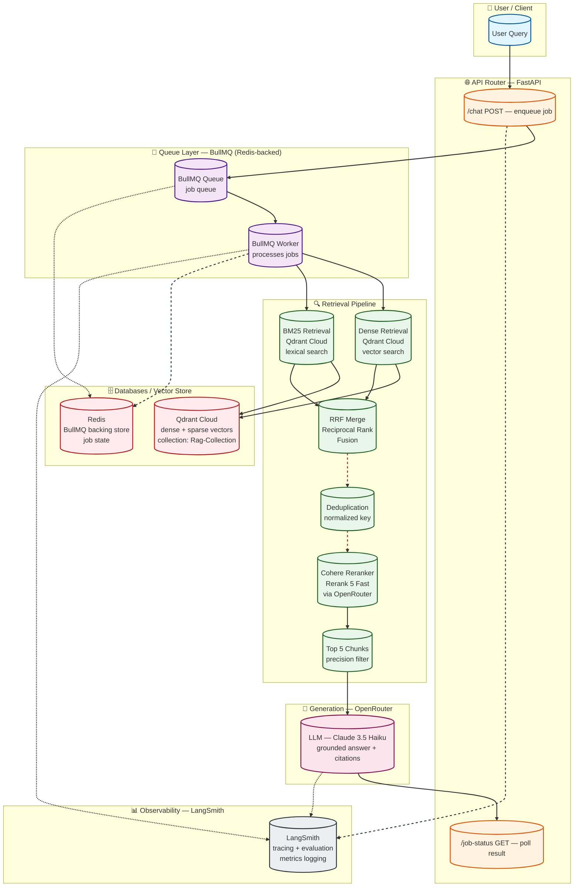

# SentinelRag — End-to-End Architecture Diagram

This diagram shows the complete RAG pipeline with databases, queue, router, and all retrieval stages.

## Diagram Components

| Component | Type | Purpose |
|-----------|------|---------|
| **FastAPI** | Router | API entry point; enqueues jobs and serves job-status polling |
| **BullMQ Queue** | Queue | Redis-backed job queue for asynchronous RAG execution |
| **BullMQ Worker** | Worker | Picks up jobs and runs the full retrieval + generation pipeline |
| **Dense Retrieval** | Retriever | Qdrant Cloud vector search — semantic matching |
| **BM25 Retrieval** | Retriever | Qdrant Cloud lexical search — exact term matching |
| **RRF Merge** | Fusion | Reciprocal Rank Fusion combining dense + BM25 rankings |
| **Deduplication** | Filter | Removes duplicate chunks by normalized text key |
| **Cohere Reranker** | Reranker | Cross-encoder precision re-ranking (top 5) |
| **Claude 3.5 Haiku** | LLM | Generates grounded answer with page citations via OpenRouter |
| **Qdrant Cloud** | Database | Vector store for dense + sparse embeddings |
| **Redis** | Database | BullMQ backing store for job state |
| **LangSmith** | Observability | Tracing, evaluation, and metric logging |
